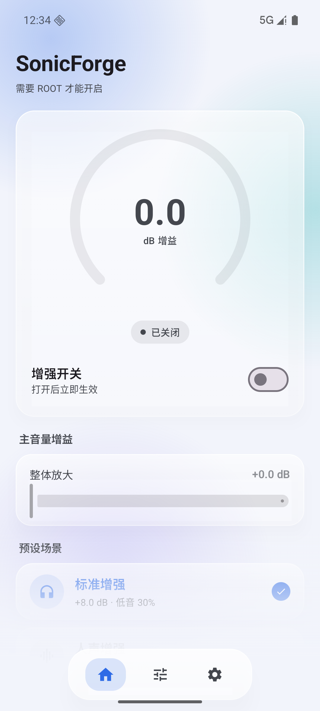
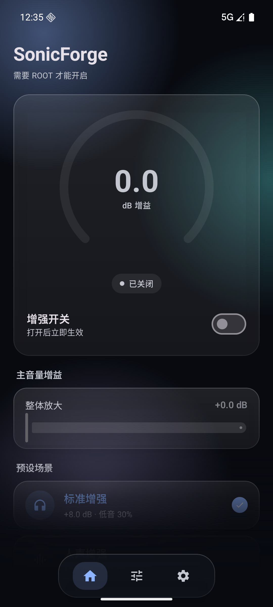
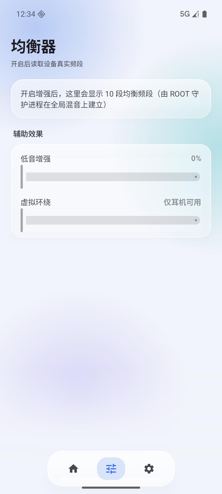
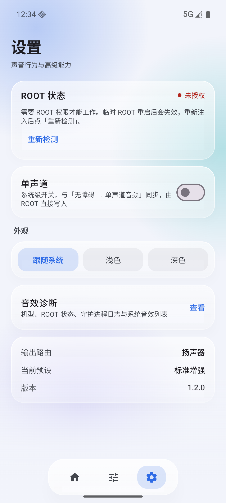

# SonicForge

**SonicForge** = Sonic（声音）+ Forge（锻造）。它不只是把声音「调大」，而是在系统音频链路上重新锻造一整套输出：全局增益、十段均衡、低音补偿、限幅防削波、硬件级 codec 增益、系统单声道。

解决手机（尤其小米 HyperOS）外放 / 媒体声音过小、推不动、一推就破音的问题。

> **只支持 ROOT。** 普通 App 在 `audioSession = 0` 创建全局音效会被 AudioFlinger 以缺少 `MODIFY_AUDIO_ROUTING` 拒绝，HyperOS 上还有杜比 / 小米音效抢占 session 0 的链路 —— 免 ROOT 的路在真机上根本走不通。所以本应用把整条效果链搬进 **uid 0 的守护进程**，没有普通模式，也没有降级模式。



<details>
<summary>更多截图：深色主页 / 均衡器 / 设置</summary>







</details>

> 截图来自 Android 16（API 36）模拟器（模拟器无 `su`，所以主页显示「需要 ROOT 才能开启」）。真机注入临时 ROOT 后副标题会变成「ROOT 已授权 · 硬件增益可用」，毛玻璃与光斑效果也更明显。

## 功能

- 🔊 **全局音量增益 0 ~ +18 dB**：`DynamicsProcessing` 的输入增益，挂在全局混音 `session 0`，对系统里所有 App 的媒体输出生效
- 🛡️ **限幅保护**：增益与均衡都在限幅器**之前**，峰值被压到 -1.5 dBFS 以下，不会削波爆音
- 🎛️ **均衡器**：频段数量由系统真实返回（10 / 8 / 6 / 5 / 3 自动适配），每段 ±6 dB，不是写死的十段
- 🎸 **低音补偿**：叠加在最低几个频段上（≤62Hz 权重 1.0，逐级衰减到 500Hz），同样受限幅器保护
- 🎧 **虚拟环绕**：仅在插入耳机 / 蓝牙时可用，扬声器下自动置灰
- 🎙️ **单声道**：直接写系统 `master_mono`（等同于「无障碍 → 单声道音频」），ROOT 下无需任何授权
- 🎼 **4 个预设**：标准增强 +8dB / 人声增强 +9.6dB / 外放最大 +12.8dB / 夜间清晰 +6.4dB（逐级递进，默认档更克制）
- 🔓 **硬件增益**：`tinymix` 直接抬高 codec 的数字音量（最高 +12 dB）。同一通路上串联的两级衰减器只写一级，滑杆刻度就是真实增益；以首次应用前的原始值为基准，可一键恢复
- 🔒 **偏移守护**：守护进程每 1.2 秒核对一次 codec 音量，系统音量一变就以新值为基准重新补上偏移——调系统音量依然有效，但增强不会掉
- 🔓 **释放全局音效通道**：临时禁用杜比 / 小米音效包并重启 audioserver，避免它们和本应用抢 session 0 的音效槽位
- 🌙 **Material 3 明暗主题**、毛玻璃卡片、iOS 风格底部 Dock，单页面简洁 UI
- ✨ **克制的动效**：页面切换用 fade through（旧页 90 ms 淡出，新页延迟 90 ms 淡入并 0.94→1.0 缩放），Dock 按下是图标微缩 + 胶囊泛色，没有水波纹方块
- 📵 **零危险权限**：不申请 `RECORD_AUDIO`、`MODIFY_AUDIO_SETTINGS`、`WRITE_SETTINGS`、`FOREGROUND_SERVICE`、`POST_NOTIFICATIONS`
- 🔕 **无常驻通知**：效果链由守护进程承载，App 可以退出、可以被划掉

## 环境要求

| 项目 | 要求 |
|---|---|
| 系统 | Android 9.0（API 28）及以上；开发测试目标为小米 18 Pro Max / Android 17 / HyperOS |
| ROOT | 设备已有可用的 `su`（KernelSU / SukiSU / Magisk，或临时 ROOT 工具注入）并授权本应用 |
| 硬件增益 | 设备自带 `tinymix`（`/vendor/bin`、`/system/bin` 或 `/system/xbin`）；没有则只影响硬件增益这一项 |
| 构建 | JDK 17+、Android SDK 35；Gradle 8.9（wrapper 已配置）、AGP 8.7.3、Kotlin 2.0.21 |

## 构建

```bash
# Android Studio：直接 Open 本目录即可
# 命令行（需已安装 Android SDK，设置 ANDROID_HOME）：
./gradlew assembleDebug        # Windows: gradlew.bat assembleDebug
# 产物：app/build/outputs/apk/debug/app-debug.apk
```

> **release 构建必须保留 `proguard-rules.pro` 里的 `-keep class com.sonicforge.app.daemon.RootDaemon`。** 守护进程由 `app_process` 按类名反射启动，R8 看不到这个引用，去掉 keep 规则会把类删掉，release 包装上后开开关会直接失败。

## 安装与使用

```bash
adb install -r app/build/outputs/apk/debug/app-debug.apk
```

1. **先注入 ROOT**（临时 ROOT 工具如 HyperBreak，或已持久化的 KernelSU / Magisk），确认 `su` 可用
2. 打开 App，首次会弹 su 授权框，点「允许」
3. 选一个预设（推荐先用「标准增强」），打开「增强开关」
4. 播放任意音乐 / 视频，拖动「主音量增益」到合适位置
5. 想更响：设置页 →「ROOT 状态」→ 拖「硬件增益」（最多 +12 dB）
6. 关闭开关即完全恢复原声；点「恢复原始值」把 codec 音量写回

> 临时 ROOT **重启即失效**。重启后重新注入 ROOT，再打开 App 点设置页的「重新检测」即可。

## ROOT 能力

| 能力 | 做法 | 说明 |
|---|---|---|
| **ROOT 全局音效** | 用 `su` 起一个 uid 0 的 `app_process` 守护进程（`RootDaemon`），在进程内把 `DynamicsProcessing` 挂到 session 0 | 普通 App 创建全局音效会被 AudioFlinger 以缺少 `MODIFY_AUDIO_ROUTING` 拒绝；uid 0 进程不受此限制，这是真机报「系统拒绝了音效创建」的正解 |
| **硬件增益** | `tinymix` 读写 codec 的数字音量控件 | 唯一能突破「数字信号已到 0 dBFS」天花板的手段，最高 +12 dB。同一 RX 通路上 `Digital Volume` 与 `Mix Digital Volume` 是**串联的两级**，只写其中一级，所以滑杆刻度就是真实增益；以首次应用前的原始值为基准，反复拖动不叠加，可一键恢复 |
| **偏移守护** | 守护进程每 1.2 秒读一次 codec 当前值，发现被系统改写就重新补上偏移 | 调系统音量时 AudioService 会重写这些寄存器，把增强冲掉。守护进程以「用户当前音量」为新基准重新加偏移，所以调音量依然有效、增强也不会掉；关闭开关时把偏移减掉，正好回到用户自己的档位 |
| **释放全局音效通道** | `pm disable-user --user 0 <厂商音效包>` + `setprop ctl.restart audioserver` | 杜比 / DTS / 小米音效会独占 session 0 的音效链路，禁掉后本应用的音效才能挂上去；可随时恢复 |

### 守护进程

- **位置**：`com.sonicforge.app.daemon.RootDaemon`，通过 `app_process` 以 uid 0 启动
- **启动命令**：`CLASSPATH=<apk> nohup setsid app_process /system/bin com.sonicforge.app.daemon.RootDaemon <cmd> <status> >> <log> 2>&1 &`
- **通信**：文件轮询，App 写 `files/sf_daemon.cmd`，守护进程每 250 ms 读一次，状态写 `files/sf_daemon.status`；音效参数（`active/boost/eq/bass/virt`）与硬件音量守护参数（`mixer_*`）分行存放，两边互不覆盖
- **硬件音量守护**：`mixer_offset` 是相对用户音量的偏移档位（0.5 dB/档），`mixer_names` 是 `名字|基准值|最小|最大` 的列表；守护进程每 1.2 秒核一次，只在值被别人改动时补写，不会每轮都写寄存器
- **心跳**：每 2 秒刷新一次状态文件的 `ts`；App 启动时读心跳，若发现它还在跑就自动接管界面状态（不会出现「显示已关闭但声音还在增强」）
- **生命周期**：关闭开关写 `active=0`，守护进程自行释放音效并退出；配置文件被删除超过 5 秒也会自动退出
- **后台常驻**：用 `setsid` 脱离 App 会话，并把 `oom_score_adj` 调到 `-900`，App 退出 / 被划掉后仍继续工作；**因此不需要前台服务，也不显示常驻通知**
- **仍会失效的两种情况**：手动杀掉守护进程；手机重启（临时 ROOT 本身失效）
- **日志**：`files/sf_daemon.log`，也可在设置页「音效诊断」里查看尾部

## 原理与限制

- 效果链挂在 `audioSession = 0`（全局混音输出），对所有 App 的媒体流生效。
- 主链路是一条 `DynamicsProcessing`：**输入增益 → preEq → limiter → 输出**。顺序由系统保证，增益和均衡都在限幅器之前，所以推上去的峰值一定会被压回 0 dBFS 以下。
- 若机型拒绝创建 `DynamicsProcessing`（频段数不支持），守护进程会按 10 / 8 / 6 / 5 / 3 逐个重试；全部失败才退到单个 `LoudnessEnhancer`（无限幅，增益上限压到 +8 dB），并在诊断里写明。
- 都失败时界面显示「系统拒绝了音效创建」，不会假装成功。
- 均衡器频段数量与中心频率全部来自系统返回，界面按真实频段渲染；当前模式不支持的控件自动置灰。
- 单声道写系统设置 `master_mono`，ROOT 下直接写，不需要「修改系统设置」权限。
- 不申请 `RECORD_AUDIO`，不捕获任何音频数据，纯输出侧处理。
- 有线 / 蓝牙耳机同样有效，但耳机端音量独立控制，需两端同时调。
- 长期高增益 + 高音量有损扬声器风险，建议增益 ≤ +12 dB、系统媒体音量 ≤ 80%。
- App 本身不含任何提权或漏洞利用代码，只在系统已经提供 `su` 时使用它。

## 常见问题

**主页显示「需要 ROOT 才能开启」**
`su` 没拿到。确认临时 ROOT 已注入，打开 App 后点设置页「重新检测」；KernelSU 里也要允许本应用。

**设置页显示「需要 ROOT 权限才能工作」**
同上。可先到 KernelSU 管理器的「超级用户」列表里手动授予 `com.sonicforge.app`。

**开关能打开，但没声音变化**
到设置页点「音效诊断」，看 `【ROOT 守护进程】` 段：`mode=FULL` 表示链路正常；`mode=DEGRADED` 表示只挂上了 LoudnessEnhancer；`error` 行会写明失败原因。把这段文本贴到 issue 里即可定位。

**硬件增益滑杆是灰的**
两种可能：设备没有 `tinymix`（部分 ROM 精简掉了），或者没匹配到可写的输出音量控件。打开设置页「音效诊断」，看「混音器工具」「声卡」「匹配到的音量控制」三行；若「控制项总数」不为 0 但「匹配到的音量控制」为 0，把诊断里那段「候选控制项」列表贴到 issue，即可补充匹配规则。

**调了系统音量之后增强好像没了**
不会掉。守护进程每 1.2 秒核对一次，发现 codec 音量被系统重写就按新音量重新补上偏移。若想确认，拖一下硬件增益滑杆，明细里会显示当前写入值。

**重启后失效**
临时 ROOT 重启即失效，属预期行为。持久化 ROOT（KernelSU / Magisk 模块）可做到开机自启。

## 工程结构

```
app/src/main/java/com/sonicforge/app/
├── SonicForgeApp.kt              # Application，预初始化引擎并注入 ROOT 客户端
├── audio/
│   ├── AudioEngine.kt             # 效果链状态机（OFF / ROOT / UNSUPPORTED）
│   ├── AudioEngineProvider.kt     # 引擎单例
│   └── Preset.kt                  # 4 个预设参数
├── daemon/
│   └── RootDaemon.kt              # uid 0 守护进程：在 session 0 建 DynamicsProcessing 链
├── root/
│   ├── RootShell.kt               # su 探测与命令执行
│   ├── RootDaemonClient.kt        # 守护进程的启停与文件通信
│   ├── RootAudioManager.kt        # tinymix 硬件增益 / 单声道 / 厂商音效开关
│   └── MixerControl.kt            # tinymix 输出解析
└── ui/
    ├── MainActivity.kt            # 单 Activity + Compose 入口
    ├── App.kt                     # 简洁主界面
    └── theme/Theme.kt             # Material 3 主题
```

## 许可

MIT
